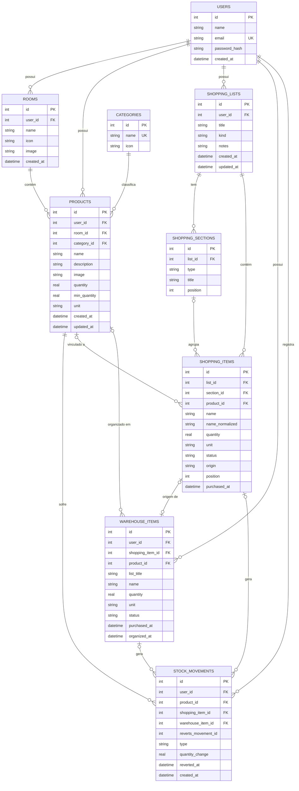

# DOMUS

Aplicativo mobile para organizar a casa: controla os produtos de cada cômodo, avisa quando o estoque está baixo e transforma isso em listas de compras que atualizam o estoque sozinhas.

## 1. O problema

Em casa, é comum não saber o que ainda tem em cada cômodo. O resultado: produtos que acabam sem ninguém perceber, compras repetidas de itens que já existiam, idas extras ao mercado e listas feitas de memória ou em vários papéis. Quem não tem familiaridade com tecnologia também encontra dificuldade em apps complexos de controle de estoque.

## 2. Como o aplicativo resolve

- O usuário cadastra **cômodos** e os **produtos** de cada um, com quantidade atual, **quantidade mínima** e unidade de medida.
- O app mostra, com cor, ícone e texto, o que está com **estoque baixo** ou **zerado**.
- A **Lista inteligente** sugere automaticamente o que repor, e o usuário também cria suas próprias **listas de compras**, com seções, divisores, observações e atalhos de texto (`- Arroz #2 kg`).
- Ao marcar um item como comprado, a **organização inteligente** (botão de lâmpada) soma a quantidade ao estoque. Quando não há certeza do produto, o item vai para o **Armazém de Compras**, onde o usuário confirma com um toque.
- A tela **Início** resume a casa e mostra os cômodos em um carrossel.

## 3. Justificativa pessoal

> Rascunho: adapte com um exemplo real da sua rotina.

Organizar a casa exige lembrar o que existe, o que está acabando e o que precisa ser comprado. Fazer isso de cabeça gera esquecimentos e desperdício. Com o Domus, o estoque fica registrado por cômodo, os alertas avisam antes de faltar algo, e as listas de compras nascem prontas a partir do que realmente está acabando. Na hora da compra, marcar o item atualiza o estoque sem digitar nada de novo, o que torna as compras mais eficientes e a organização doméstica mais leve e constante.

## 4. Tecnologias

**Aplicativo:** React Native, Expo, JavaScript, React Navigation (Stack + Bottom Tabs), React Native Paper, Context API, AsyncStorage, Expo Image Picker, Expo Image Manipulator, Expo Notifications.

**Backend:** Node.js, Express, API REST, JWT, bcrypt (via `bcryptjs`), SQLite (módulo nativo `node:sqlite`).

**API externa:** [Open Food Facts](https://world.openfoodfacts.org/data), usada para preencher o cadastro de alimentos.

**Ferramentas:** VS Code, Git e GitHub, PowerShell (`Invoke-RestMethod`) para testar os endpoints.

## 5. Como executar a API

Requisitos: Node.js 22.5 ou superior (testado com Node 24).

```bash
cd api
npm install
```

Crie o arquivo `.env` a partir do exemplo e defina um segredo para o JWT:

```bash
copy .env.example .env
node -e "console.log(require('crypto').randomBytes(32).toString('hex'))"
```

Cole o valor gerado em `JWT_SECRET` dentro do `.env`. Depois:

```bash
npm run dev
```

A API fica em `http://localhost:3000` (teste em `/health`). O banco SQLite é criado sozinho em `api/data/`.

## 6. Como executar o aplicativo

```bash
cd app
npm install
copy .env.example .env
npx expo start --web
```

- No **navegador**, `EXPO_PUBLIC_API_URL=http://localhost:3000` funciona.
- No **celular** (Expo Go), defina no `.env` o IP do computador na rede, por exemplo `EXPO_PUBLIC_API_URL=http://192.168.0.10:3000`, e use o mesmo Wi-Fi. No emulador Android, use `http://10.0.2.2:3000`.
- Depois de mudar o `.env`, reinicie com `npx expo start --clear`.
- Câmera e notificações locais funcionam apenas no aplicativo do celular.

## 7. Integração entre o app e o backend

1. O app nunca acessa o banco. Toda comunicação passa pela API REST, usando `fetch` em um único arquivo (`app/src/services/api.js`).
2. No login, a API devolve um **token JWT**. O app o guarda no **AsyncStorage** e o envia no cabeçalho `Authorization: Bearer <token>` em toda requisição.
3. A API valida o token em um middleware e filtra **todas** as consultas pelo usuário logado, então ninguém acessa dados de outra conta.
4. Os dados principais ficam no banco da API. O AsyncStorage guarda apenas o token e preferências (organização inteligente e alertas de estoque).
5. A regra de negócio fica na API (situação do estoque, atualização por compras, movimentações). O app só exibe os resultados.

Estrutura do repositório:

```text
Domus/
├── app/   aplicativo mobile (React Native + Expo)
└── api/   backend (Node.js + Express + SQLite)
```

Cada parte segue camadas separadas. Na API: `routes`, `controllers`, `services`, `repositories`, `middlewares` e `database`. No app: `screens`, `components`, `navigation`, `context`, `hooks`, `services`, `storage` e `utils`.

## 8. Principais endpoints

| Área | Endpoints |
|---|---|
| Autenticação | `POST /auth/register`, `POST /auth/login`, `GET` e `PUT /auth/me`, `PUT /auth/password` |
| Cômodos | `GET/POST /rooms`, `GET/PUT/DELETE /rooms/:id` |
| Produtos | `GET/POST /products`, `GET/PUT/DELETE /products/:id`, `PATCH /products/:id/quantity` |
| Categorias | `GET /categories` |
| Listas | `GET/POST /shopping-lists`, `GET/PUT/DELETE /shopping-lists/:id`, `PUT /shopping-lists/:id/order`, `POST /shopping-lists/:id/sections`, `POST /shopping-lists/:id/commands`, `POST /shopping-lists/smart/sync` |
| Seções | `PUT/DELETE /shopping-sections/:id` |
| Itens | `GET/POST /shopping-items`, `PUT/DELETE /shopping-items/:id`, `PATCH /shopping-items/:id/status` |
| Armazém | `GET/POST /purchase-warehouse`, `GET /purchase-warehouse/count`, `PUT/DELETE /purchase-warehouse/:id`, `POST /purchase-warehouse/:id/organize` |
| Movimentações | `GET/POST /stock-movements` |

## 9. DER do banco de dados



Regras importantes do modelo:

- A **situação do estoque** não é guardada: é calculada na consulta (sem estoque se a quantidade é 0, baixo se é menor ou igual ao mínimo, normal nos demais casos), por isso nunca fica desatualizada.
- Cada compra que muda o estoque gera uma linha em `STOCK_MOVEMENTS`. Índices únicos impedem que o mesmo item atualize o estoque duas vezes.
- Excluir um cômodo exclui os produtos dele (`ON DELETE CASCADE`). Excluir uma seção mantém os itens (`ON DELETE SET NULL`).

## 10. Principais funcionalidades

- Cadastro e login com senha protegida por hash e sessão por JWT.
- Cômodos com ícone ou foto, e resumo do estoque em cada um.
- Produtos com quantidade, mínimo, unidade, categoria, foto, alertas e ordenação.
- Preenchimento do cadastro pelo Open Food Facts (opcional).
- Tela Início com resumo da casa, carrossel de cômodos e atalhos.
- Lista inteligente, listas personalizadas (em andamento e concluídas), seções, divisores, observações e comandos de texto.
- Organização inteligente (lâmpada) e Armazém de Compras, com botão flutuante com contador.
- Histórico de movimentações do estoque, com reversão segura.
- Notificações visuais temporárias e alertas locais de estoque.
- Perfil com alteração de nome, e-mail e senha.

## 11. Em desenvolvimento

Tarefas, Receitas e Compartilhamento da residência aparecem como atalhos na tela Início e serão implementados em versões futuras.